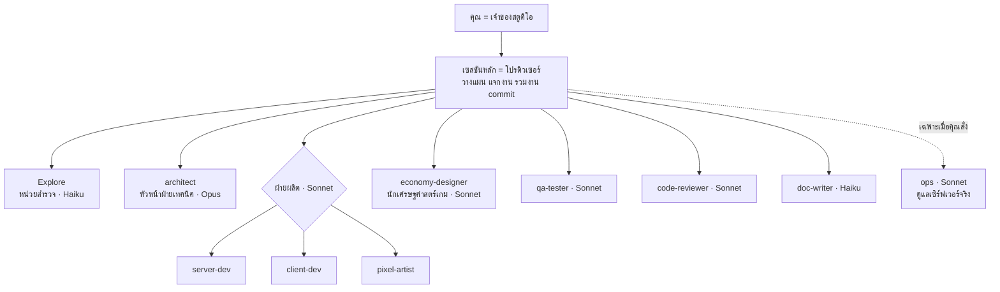

# แผนทีมงาน Subagent ของ My World ("สตูดิโอเกมเล็กๆ")

เอกสารนี้คือแผนจัดทีม Claude Code ให้ทำงานแบบบริษัทเกมเล็กๆ แบ่งตำแหน่ง แบ่งไฟล์ แบ่งขั้นตอน เพื่อให้แก้งานเป็นส่วนๆ ได้ และคุมค่า token ในระยะยาว
ไฟล์ทั้งหมดในชุดนี้วางลงรากรีโปได้ตรงตาม path

---

## 1. ความจริงเรื่อง token ที่ต้องรู้ก่อน

Subagent **ไม่ได้ลด token โดยอัตโนมัติ** ทุกตัวที่ถูกเรียกเริ่มจากหน้าว่าง แล้วต้องโหลดของพวกนี้ทุกครั้ง:

- system prompt ของตัวเอง (ไฟล์ใน `.claude/agents/`)
- `CLAUDE.md` ทั้งไฟล์ (ยกเว้นตัวที่ตั้ง `omitClaudeMd: true`)
- ข้อความสั่งงานจากเซสชันหลัก
- ไฟล์โค้ดที่มันต้องอ่านเอง

และการใช้งานของทุก agent นับรวมในโควตาเดียวกับเซสชันหลัก ถ้าเรียก agent 5 ตัวมาอ่าน `server.js` 3,800 บรรทัดคนละรอบ จะแพงกว่าทำเองในเซสชันเดียว

**token จะลดลงจริงเมื่อ:**

1. **งานแต่ละตัวอ่านไฟล์น้อยลง** — นี่คือคันโยกใหญ่ที่สุด และต้องมาจากการ refactor ให้ระบบละไฟล์ (แผน refactor เดิม) ทีมนี้จึงช่วยได้เต็มที่หลัง refactor
2. **ใช้โมเดลถูกกับงานง่าย** — สำรวจโค้ดและเขียนเอกสารใช้ Haiku, งานเขียนโค้ดใช้ Sonnet, ใช้ Opus เฉพาะการออกแบบ
3. **เซสชันหลักไม่บวม** — ผลค้นหา ผลเทสต์ log ยาวๆ อยู่ใน context ของ agent กลับมาแค่สรุปสั้น เซสชันหลักจึงคุยได้นานโดยไม่ต้องบีบอัด
4. **`CLAUDE.md` สั้น** — ไฟล์นี้เข้าไปในทุก agent ทุกครั้ง ตอนนี้ 15.4 KB ฉบับเสนอเหลือ 5.8 KB (ลด ~62%) ส่วน VPS/deploy/backup ย้ายไป `docs/OPS.md` ที่ agent `ops` อ่านเฉพาะตอนใช้
5. **ใช้ตั๋วงานแทนการอธิบายซ้ำ** — เซสชันหลักเขียนตั๋วครั้งเดียว ทุก agent อ่านจากไฟล์
6. **agent มีความจำของโปรเจกต์** (`memory: project`) — Explore จำแผนที่โค้ด, economy จำบทเรียนการปรับค่า, reviewer จำข้อผิดพลาดที่เจอบ่อย ไม่ต้องสำรวจใหม่ทุกครั้ง
7. **รายงานกลับสั้นและมีรูปแบบตายตัว** — ทุก agent ถูกกำหนดจำนวนบรรทัดสูงสุดของรายงาน
8. **ไม่เรียก agent กับงานเล็ก** — แก้ไม่เกิน ~20 บรรทัดในไฟล์ที่รู้ตำแหน่งแล้ว ทำในเซสชันหลักถูกกว่า

---

## 2. ผังบริษัท



ไม่ใช้ "โปรดิวเซอร์" เป็น agent แยก เพราะเซสชันหลักของ Claude Code ทำหน้าที่นี้ได้ดีอยู่แล้ว และเห็นบทสนทนากับคุณทั้งหมด กติกาของโปรดิวเซอร์เขียนไว้ใน `CLAUDE.md` หัวข้อ "ทีมงาน"

---

## 3. ตำแหน่งงาน

| Agent | หน้าที่ | โมเดล | แก้ไฟล์ได้ | ความจำ |
|---|---|---|---|---|
| `Explore` | หาว่าโค้ดอยู่ไหน ตอบเป็นแผนที่ `ไฟล์:บรรทัด` (แทนที่ Explore ในตัว ให้รันบน Haiku และไม่โหลด CLAUDE.md) | haiku | ไม่ได้ | project |
| `architect` | ออกแบบงานที่แตะ 2 ระบบขึ้นไป, refactor, เปลี่ยนไฟล์เซฟ | opus (effort high) | `docs/plans/` เท่านั้น | project |
| `server-dev` | กติกาเกม handler ข้อความ การเซฟ กันโกง | sonnet | `server.js`, `server/**`, กติกาใน shared | – |
| `client-dev` | UI HUD input การวาด มือถือ | sonnet | `public/game.js`, `index.html`, `public/client/**` | – |
| `pixel-artist` | พิกเซลอาร์ตตาม STYLE_GUIDE | sonnet | `public/pixel*.js`, `packart.js`, `hdchar.js`, `pack/`, `sprites/` | – |
| `economy-designer` | ราคา XP เวลา โอกาส พิสูจน์ด้วย simulator | sonnet (effort high) | ตัวเลขใน shared data + บันทึกใน `ECONOMY-PLAN.md` | project |
| `qa-tester` | รันเทสต์ทั้งหมด เขียนเทสต์ใหม่ | sonnet (effort medium) | `tools/test-*.js` เท่านั้น | – |
| `code-reviewer` | ตรวจ diff: ความปลอดภัย ช่องโกง กติกาโปรเจกต์ | sonnet | ไม่ได้ | project |
| `doc-writer` | อัปเดตเอกสารหลังเปลี่ยนกติกา | haiku | `*.md` เท่านั้น | – |
| `ops` | deploy restart health log บน VPS | sonnet (ถามสิทธิ์ทุกครั้ง) | ไม่แก้ไฟล์ | – |

กติการ่วมของทุกตัว: **ไม่ commit ไม่ push** (โปรดิวเซอร์ทำ), รายงานสั้นตามรูปแบบ, งานนอกขอบเขตให้เขียนเป็น "Hand-offs" แล้วส่งกลับ ไม่แก้ข้ามแดน

system prompt ของ agent เขียนเป็นภาษาอังกฤษโดยตั้งใจ เพราะภาษาอังกฤษใช้ token น้อยกว่าภาษาไทยมากสำหรับข้อความยาวเท่ากัน แต่ทุกตัวถูกสั่งให้ใช้ภาษาไทยกับข้อความในเกมและเอกสาร

---

## 4. ขอบเขตไฟล์ (ใครเป็นเจ้าของอะไร)

ขอบเขตชัด = แก้งานเป็นส่วนๆ ได้ และ agent สองตัวทำพร้อมกันได้โดยไม่ชนกัน

| ช่วง | server-dev | client-dev | pixel-artist | economy-designer |
|---|---|---|---|---|
| ตอนนี้ (ก่อน refactor) | `server.js` | `public/game.js`, `index.html` | `public/pixel*.js` ฯลฯ | ตัวเลขใน `public/shared.js` |
| หลัง refactor | `server/systems/<ระบบ>.js` | `public/client/systems/<ระบบ>.js` | `public/client/render/**` | `shared/data/<ระบบ>.js` |

ข้อควรระวังตอนนี้: `server.js` และ `game.js` เป็นไฟล์ยักษ์ไฟล์เดียว ถ้าให้ agent สองตัวแก้ไฟล์เดียวกันพร้อมกันจะชนกัน **ก่อน refactor ให้ทำทีละตัว** หลัง refactor ค่อยให้ทำพร้อมกันตามระบบ

---

## 5. ขั้นตอนมาตรฐาน (SOP)

พิมพ์คำสั่งเหล่านี้ใน Claude Code เพื่อเรียกขั้นตอนเต็ม (ไฟล์อยู่ใน `.claude/skills/`):

**`/feature` — ฟีเจอร์ใหม่**
ตั๋ว → Explore หาตำแหน่ง → architect (ถ้าแตะหลายระบบ/ไฟล์เซฟ) → economy (ถ้ามีตัวเลข) → server-dev → client-dev → pixel-artist (ถ้ามีภาพ) → qa-tester → code-reviewer → doc-writer → สรุปให้คุณ → commit เมื่อคุณตกลง

**`/bugfix` — แก้บั๊ก**
อ่านรายงานบั๊ก (`node tools/bugs.js <id>`) → Explore หาสาเหตุ → แก้เอง (ถ้าเล็ก) หรือส่ง dev เจ้าของ → qa เพิ่มเทสต์กันบั๊กกลับมา → reviewer → สรุป

**`/ship` — ขึ้นเกมจริง** (เรียกได้เฉพาะคุณพิมพ์เอง Claude เรียกเองไม่ได้)
เช็ก git status → เทสต์ผ่าน → commit ทีละไฟล์ + push → ยืนยันเวลากับคุณ → ops deploy + เช็ก health

**ปรับสมดุล** (ไม่ต้องมีคำสั่ง แค่บอก "ให้ economy-designer ดูเรื่อง…")
economy รัน levelsim/econsim ก่อน-หลัง → บันทึกใน ECONOMY-PLAN → qa → reviewer

**refactor** — ดูหัวข้อ 9

---

## 6. รูปแบบการส่งงาน

**ตั๋วงาน** `docs/tasks/<slug>.md` (แม่แบบที่ `docs/tasks/_TEMPLATE.md`): ต้องการอะไร, เกณฑ์ว่าเสร็จ, ตำแหน่งในโค้ด (Explore เติม), งานของแต่ละตำแหน่ง, คำตัดสินใจ
commit ตั๋วไว้ได้ ถ้าอยากทำต่อจากอีกเครื่อง

**แผนออกแบบ** `docs/plans/<slug>.md` (architect เขียน): เป้าหมาย ระบบที่กระทบ protocol ข้อความ การเปลี่ยนไฟล์เซฟ ขั้นตอนย่อย ความเสี่ยงและวิธีถอย

**รายงานกลับ** ทุก agent มีจำนวนบรรทัดสูงสุด (10–25 บรรทัด) และรูปแบบตายตัว เช่น server-dev ต้องบอก: ไฟล์ที่แก้, ข้อความที่เพิ่ม/เปลี่ยน, เทสต์ที่รันและผล, ความเสี่ยง, Hand-offs

---

## 7. ระบบความปลอดภัยในชุดนี้

- **`.claude/settings.json`** ห้ามอ่าน `admin.key` / `.env`, ห้าม `git push --force`, `git reset --hard`, `rm -rf data` / `backup` (มีผลกับเซสชันหลักและทุก agent)
- **hook `.claude/hooks/check-js.js`** หลังแก้หรือสร้างไฟล์ `.js` ทุกครั้ง รัน `node --check` ทันที ถ้า syntax พัง Claude จะเห็น error และแก้เองก่อนไปต่อ (ทดสอบแล้วว่าทำงาน)
- **`ops`** ใช้ `permissionMode: default` ถามสิทธิ์ก่อนรันคำสั่งทุกครั้ง และ description บอกชัดว่าใช้เฉพาะเมื่อคุณสั่ง
- **`code-reviewer`** มี checklist เฉพาะเกมนี้: server ไม่เชื่อ client, ช่องปั๊มของ/เงินติดลบ/NaN, `dirty` flag, escape ข้อความผู้เล่นก่อนใส่ `innerHTML` (ตอนนี้ `game.js` ใช้ `innerHTML` 52 จุด), ความลับใน diff

---

## 8. สิ่งที่ต้องแก้ในรีโปก่อนใช้

1. **`.gitignore` ตอนนี้มี `.claude/`** ซึ่งจะทำให้ agent ทั้งทีมไม่ขึ้น git และไม่ซิงก์ไปเครื่องอื่น (โรงงาน บ้าน VPS) ให้เปลี่ยนบรรทัด `.claude/` เป็น:
   ```
   .claude/settings.local.json
   .claude/agent-memory-local/
   ```
   (ลบไฟล์ `gitignore` ที่ไม่มีจุดซ้ำด้วยก็ได้)
2. แทน `CLAUDE.md` ด้วย `proposed/CLAUDE.md` และเพิ่ม `docs/OPS.md` (เนื้อหาย้ายมาจาก CLAUDE.md เดิมทั้งหัวข้อ ไม่ได้แต่งใหม่) อ่านเทียบก่อนแทน
3. ความจำของ agent (`.claude/agent-memory/`) จะขึ้น git ด้วย ใช้ร่วมกันทุกเครื่อง `git pull` ก่อนเริ่มงานตามกฎเดิมเพื่อไม่ให้ชนกัน

---

## 9. แผนเปิดใช้ทีละระยะ

**ระยะ 1 — ตั้งทีม (วันแรก ~1 ชม.)**
- วางไฟล์ แก้ `.gitignore` แทน CLAUDE.md commit + push
- ทดลองทีละตัวด้วยงานเล็ก (ดูหัวข้อ 10) แล้วดูว่าแต่ละตัวรันบนโมเดลที่ตั้งไว้ด้วย `/tasks` ขณะ agent ทำงาน
- ถ้าตัวไหนไม่ถูกเรียกหรือทำงานผิดขอบเขต ปรับ description / prompt

**ระยะ 2 — ใช้ทีมทำ refactor ขั้น 0–1 ตาม `docs/plans/REFACTOR-PLAN.md` (1–2 สัปดาห์)**
- `qa-tester` เขียน golden test (โหลดสำเนาเซฟ ยิงข้อความชุดหนึ่ง เทียบผล) และเทสต์ของ arcade/economy/trade ที่ยังไม่มี
- `architect` เขียน `docs/plans/refactor.md` จาก `docs/plans/REFACTOR-PLAN.md`
- `server-dev` ย้ายระบบออกจาก `World` แบบ mixin ทีละระบบ (lotto → cinema → arcade → npc → pets → …) ระบบละ 1 commit
- `code-reviewer` ตรวจทุกครั้ง qa รันเทสต์ทั้งหมด + golden test ทุกครั้ง
- ช่วงนี้ทำทีละ agent เพราะยังเป็นไฟล์ใหญ่ไฟล์เดียว

**ระยะ 3 — หลังแยกระบบแล้ว**
- อัปเดตขอบเขตไฟล์ใน prompt ของ dev ให้ชี้ `server/systems/` และ `public/client/systems/`
- ให้ server-dev กับ client-dev ทำพร้อมกันได้เมื่อไฟล์ไม่ทับกัน หรือเพิ่ม `isolation: worktree` ใน frontmatter ให้ dev ที่ต้องทำขนานกันจริงๆ (แต่ละตัวได้สำเนารีโปแยก ต้อง merge กลับเอง)
- ถ้าบางระบบใหญ่และแก้บ่อย (เช่น arcade, house) พิจารณาเพิ่ม agent เฉพาะระบบนั้น

**ระยะ 4 — ปรับจูน (ทุกเดือน)**
- agent ตัวไหนแทบไม่ได้ใช้ ให้รวมหรือลบ (description ทุกตัวกิน context ของเซสชันหลักทุกครั้ง)
- เทียบการใช้งาน token ของงานประเภทเดียวกันก่อน-หลัง
- ดูไฟล์ความจำของ agent (`.claude/agent-memory/*/MEMORY.md`) ตัดของเก่าที่ไม่จริงแล้ว

---

## 10. วิธีเริ่มคุยกับ Claude Code (ก๊อปไปใช้ได้)

เปิด Claude Code ที่รากรีโปแล้วเริ่มด้วย:

```
อ่าน docs/plans/AGENTS-PLAN.md แล้วตรวจว่า agent ทั้ง 10 ตัวใน .claude/agents โหลดได้ครบ
บอกชื่อ โมเดล และขอบเขตของแต่ละตัวเป็นตารางสั้นๆ ยังไม่ต้องแก้โค้ด
```

ทดลองทีละตำแหน่ง:

```
@"Explore (agent)" ระบบล็อตโต้ออกรางวัลที่ไหน และเก็บข้อมูลไว้ใน state ตัวไหน
```
```
ให้ qa-tester รันเทสต์ทั้งหมดแล้วรายงานเฉพาะที่พัง
```
```
ให้ code-reviewer ตรวจ commit ล่าสุด (git diff HEAD~1)
```
```
ให้ economy-designer รัน levelsim กับ econsim แล้วสรุปเคส 2 ใน docs/reports/ISSUES-2026-10.md ว่าตัวเลขตอนนี้เป็นยังไง ยังไม่ต้องแก้ค่า
```

เริ่มงานจริง:

```
/feature เพิ่มม้านั่งข้างไร่ 2 ตัว ตามทางแก้ (ก) เคส 1 ใน docs/reports/ISSUES-2026-10.md
```

---

## 11. Deploy และการทำงานหลายเครื่อง
- ลำดับงาน: dev ที่เครื่อง → push GitHub → `tools/deploy.sh` บน VPS (ผ่าน agent `ops` หรือ `/ship`) รายละเอียดใน `docs/OPS.md`
- ทำงานจาก 3 เครื่อง: `docs/SETUP-MACHINES.md` • ส่งต่อสถานะด้วย `/handoff` → `docs/HANDOFF.md`

- ภาพด้วย PixelLab: `pixel-artist` (ผูก MCP แล้ว) → `art/raw/` → `tools/art-import.js` → `public/pack/` บันทึก prompt ที่ `art/prompts.md`
- สำรองข้อมูลนอก VPS: `tools/pull-backup.ps1` (Windows) / `tools/pull-backup.sh`

## 12. เมื่อไหร่ "ไม่ควร" ใช้ agent

- แก้ข้อความ เปลี่ยนตัวเลขตัวเดียว แก้บั๊กบรรทัดเดียวที่รู้ตำแหน่งแล้ว
- งานที่ต้องคุยกลับไปกลับมากับคุณบ่อยๆ (agent ถามคุณระหว่างทางไม่ได้)
- งานที่ทุกขั้นต้องใช้ context ร่วมกันเยอะ ให้ทำต่อเนื่องในเซสชันหลัก

## อ้างอิง
- Subagents: https://code.claude.com/docs/en/sub-agents
- Skills: https://code.claude.com/docs/en/skills
- Hooks: https://code.claude.com/docs/en/hooks
